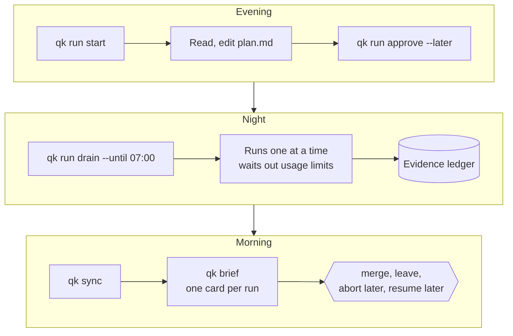

# Overnight runs

[Tiếng Việt](../vi/overnight.md) · [Docs index](README.md) · [Runner](runner.md) · [Ledger](ledger.md)

Approve plans in the evening, let the [runner](runner.md) work through them one at a time overnight, and decide on the results in the morning. You need `qk` on your `PATH` (see [Install from a clone](ledger.md#install-from-a-clone)), a primary checkout with no uncommitted changes, and macOS for `caffeinate` and `--notify`. Runner messages print the same subcommands as `qk-run …`; `qk run …` is the same command.



## Evening

1. Start each task. `start` prints the run id as `qk-run <id>`, then plans and stops with `Plan ready: …`:
   ```bash
   qk run start "Add X. Done when <check> passes." --repo <path>
   ```
2. Read `plan.md` in the run directory: `~/.local/state/qk-run/<id>/plan.md` by default, or under `$QK_RUN_STATE_DIR`, or `$XDG_STATE_HOME/qk-run`, when set. Edit it in place, or re-plan with `qk run revise <id> "<feedback>"`.
3. Queue it:
   ```bash
   qk run approve <id> --later
   ```
   `approve` re-reads `plan.md`, refuses a plan without a `qk-verify` block, freezes it as `approved-plan.md`, prints the verify commands that will run and sets the stage to `queued`.
4. Repeat for more tasks. Queued runs execute oldest first.

## Night

```bash
caffeinate -i qk run drain --until 07:00 --notify
```

A night where Claude's limit stopped two runs, the drain waited for the reset and every run finished, ends like this (each run's own progress lines come before):

```text
claude limited; 2 runs waiting until 23:52.
Drain: 4 done, 0 blocked, 0 left queued.
```

- One run at a time, oldest queued first. A second `drain` exits with `another drain is already running`.
- `--until 07:00` means the next 07:00 after now. The deadline is checked only before a run starts: the run in progress finishes, then drain prints `Deadline reached; N queued runs left.` Runs not started stay queued for the next drain.
- `--notify` shows one notification for each blocked run and one for the summary. A failed notification only prints a warning.
- Usage limits: when an agent turn stops because a runtime hit its usage limit (Claude's 5-hour or session limit, Codex's usage limit), the run blocks with `limited` (runtime and reset time) in its state. With `--until`, drain waits for it: once the queue is empty it sleeps until two minutes after the reset time the message named, says so (`claude limited; 2 runs waiting until 23:52.`), resumes those runs and carries on. A message with no reset time is retried every 30 minutes; one run is retried at most 3 times per drain. A reset after the deadline ends the drain with `Gave up: claude limit resets after the 07:00 deadline; …`, and the runs stay blocked for `qk run resume`. Only runs that came through the queue are resumed; a run blocked for any other reason is left for you. `--wait-limits` turns this on without `--until`, `--no-wait-limits` turns it off.
- The last line is `Drain: X done, Y blocked, Z left queued.`, with `(N by a usage limit)` after the blocked count when some are waiting for a limit. The exit code is 1 if any run blocked.
- Session log: every drain that holds `drain.lock` writes its own session log, `drain-YYYYMMDD-HHMMSS.log`, in the state directory next to the run directories, and prints `Drain log: <path>` at start, so no `| tee` is needed. Each line starts with a `[YYYY-MM-DD HH:MM:SS]` timestamp. The log records the start (`--until` and the deadline, `--wait-limits`, `--notify`, the queued run ids), each run's start with its `run.log` path and the stage it ended in, blocked reasons, limit waits, the deadline, and the drain end with its cause (`deadline`, `queue empty`, `limit resets after the deadline`, or `error` after Ctrl-C or an unexpected error). It holds no agent output (that is in each run's `run.log`), no environment variables, tokens or prompts. A drain refused by `drain.lock` writes nothing. A drain that cannot open its log stops before any agent turn. A killed drain may have no end line; its last `run … start` line without a matching end names the run it was working on.

## Morning

```bash
qk sync
qk brief
```

Or read the same cards in omp, Claude Code or Codex with the [qk-morning](skills/qk-morning.md) skill; the [runtime adapters](runtime-status.md) remind you at session start when cards wait.

`qk sync` reads PR state with `gh` and prints `Decision snapshots: N recorded; N unchanged; N failures.` (exit 1 on any failure). `qk brief` prints one card per run. A card for a run that is not blocked shows:

- a title line ending in `RISK: <level> — <rule>; full: qk show --id <id>` (a rule longer than 100 characters is cut);
- `Done`, `Evidence`, `Unchecked`, `History`;
- `Decision: human decision required; …`.

A blocked card shows the title line, then `Done`, `Next` and `History` only. So does a card for a run stopped mid-stage (see [When something goes wrong](#when-something-goes-wrong)).

Cards are ordered high, medium, low; within a level, stopped runs come first, then blocked runs. The first matching rule sets the level, and its text is printed:

- **high:** `stopped at <stage> (runner gone)`, `blocked at <stage>: <reason>`, `<n> blocker/important findings remain` (nit findings do not count; a run recorded before severity was kept shows `<n> findings remain (severity unknown)` and counts every remaining finding), `verify failed (<n> nonzero)`, `sensitive file <path>` (`+N more`). Sensitive means `.github/`, dependency manifests and lockfiles (`package.json`, `*.lock`, `pyproject.toml`, `go.mod`, `Cargo.toml`, `Gemfile`, `Dockerfile`, `requirements*.txt`, …), `*.tf`, `migrations/`, or a path containing `auth`, `secret`, `permission` or `policy`.
- **medium:** `fix round used`, `<n> lines changed` (over 300), `<n> files changed` (over 10), `PR head differs from recorded commit`, `never synced`, `scope unknown`.
- **low:** `no rule matched`.

The rules do not grant approval. The brief leaves out aborted runs, runs that are not blocked whose PR is merged or closed, and runs without a PR unless they are blocked or stopped mid-stage. With nothing to show, it prints `No open, unknown or blocked runs recorded.`

A blocked card shows `Next: qk run resume <id> after fixing the cause, or qk run abort <id>`; a run stopped by a usage limit shows `RISK: medium — waiting for claude limit until 23:50` and `after the limit resets` instead. Check the cause with `qk run status <id>`. `resume` runs in your terminal, not in a drain. If the run blocked at verifying, reviewing or fixing, your hand fixes are verified and reviewed again (see [Authority](runner.md#authority)). `qk run abort <id>` keeps the worktree; remove it with `git worktree remove`.

### Deciding from the terminal

When stdin and stdout are both a terminal, `qk brief` asks after each card. Piped or redirected, it only prints and makes no network call.

- Not blocked: `[y] merge  [n] leave  [d] diff  [s] skip`. `y` merges with `gh`, and only if the PR head still equals the run's recorded commit: it checks that the active `gh` account can merge in that repository (otherwise it says so before asking anything; quit and rerun with `GH_TOKEN="$(gh auth token --user <account>)" qk brief`), reads the methods the repository allows, asks which one when there are several (`merge` means a merge commit; Enter keeps the first, squash when allowed), and passes `--match-head-commit`. With a merge queue or auto-merge, GitHub can accept the merge before the PR is merged: the brief says so and records `merged=false`, and the next `qk sync` records the final state. If the merge does not happen, it prints `qk brief: not merged: <reason>` and asks again. `d` prints the PR diff and asks again. `n` records that you leave the PR.
- Blocked: `[a] abort later  [r] resume later  [s] skip`. These only record your intent; run `qk run abort` or `qk run resume` yourself.
- Stopped mid-stage: `[a] abort later  [s] skip`. `a` only records your intent.
- `s` records nothing. End of input (Ctrl-D) stops the questions; the remaining cards are printed only.

Each choice is written to the ledger as a decision with `source=user`, then prints `Recorded <choice>: <id>`. A recorded choice does not hide the card; a merged PR leaves the brief after the next `qk sync`.

Without a terminal, for example when an agent in a chat runs the commands for you, record one decision with `qk decide <run-id> merge|leave|abort-later|resume-later`. It accepts only the choices the card offers, applies the same checks before a merge (head equals the recorded commit, merge permission, `--match-head-commit`) and needs `--method` when the repository allows several. Run it only on the user's own stated choice, including the merge method; an agent must not pick one. The decision is recorded the same way, with `via=decide` instead of `via=brief` and `elapsed_s` empty because no card was timed. `source=user` attributes the choice to the user; it does not prove who typed the command. Agents that `qk-run` starts are told never to merge or run `qk decide`.

## When something goes wrong

- **A drain killed mid-run** (Ctrl-C, a closed terminal, a kill) leaves that run in its in-progress stage. `resume`, `approve` and `drain` all skip it. While a run works, the runner holds `run.lock` in its run directory and the kernel drops it when the process dies, so `qk brief` shows a run in a working stage whose lock is free as `stopped at <stage> (runner gone)`, with `Next: qk run status <id>, then qk run abort <id>`. The free lock shows only that the runner is gone: an agent it started runs in its own session and may still be finishing its turn in the worktree, so follow [Recovering a run stopped mid-stage](#recovering-a-run-stopped-mid-stage) before you abort. Only `qk run abort <id>` gets the run out. Abort leaves the branch, a pushed branch and any PR as they are.
- **Usage limits** are waited for as described under [Night](#night). **Login failures** and limits without `--until` end that run as `blocked`, and drain moves on to the next run, which may block for the same reason.
- **Two tasks at once:** drain never runs two queued runs together, but it does not stop `start`, `approve` without `--later`, or `resume` that you run by hand in another terminal.
- **Sleep:** a sleeping machine pauses the agents and the drain. Keep `caffeinate -i` in front of `drain`.

### Recovering a run stopped mid-stage

1. Make sure nothing still runs:
   - `qk brief` shows `stopped at <stage> (runner gone)`: `run.lock` is free and the runner is gone.
   - `pgrep -fl -- "<id>"` prints nothing. The run id is in every agent's command line through its run directory, and in `qk run approve|resume <id>`.

   If anything still runs, stop here and wait for it, or stop it yourself.
2. `qk run abort <id>`. It keeps the branch and the worktree, and prints the worktree path.
3. Review the uncommitted changes in the worktree: `git -C <worktree> status --untracked-files=all` and `git -C <worktree> diff`. Commit them only on a local branch you approve, for example the run's `qk/…` branch that the worktree is on. Do not push yet.
4. Before any push, check again: run the commands in the `qk-verify` block of `approved-plan.md` from the worktree root, and have the change reviewed. Push or open the PR by hand only after that.

## Publishing account

The active `gh` account must have push permission on the repository. The runner checks it at `start`, again right before the implementing stage (whether `approve` or `drain` starts it, and when `resume` retries it), and right before the push; `gh pr create` also uses that account. `git push` uses git's own credentials, so they must be able to push too; with an SSH origin, the key decides, and the check cannot tell which account owns it. From the qk clone, check without changing anything:

```bash
python3 skills/qk-commit/scripts/qk_preflight.py identity --repo <path>
```

A failed check before implementing blocks the run at `implementing` with the check's report and calls no agent. Switch the account (Way 1 or Way 2 below), then `qk run resume <id>`. A drain moves on to the next run, which blocks the same way until the account is fixed.

**Way 1: switch the active account.** Run `gh auth switch -u <other-account>` before `start`, keep it through the drain, then `gh auth switch -u <your-account>` afterwards. This covers `git push` only when git gets github.com credentials from `gh auth git-credential`; check with `git config --get-regexp '^credential'`. The switch is global, so every other terminal sees it too.

**Way 2: one terminal only, no global change.** `GH_TOKEN` takes precedence over the stored `gh` login, and the `GIT_CONFIG_*` variables add git config for this shell and its children. The empty helper clears your other credential helpers for github.com:

```bash
export GH_TOKEN="$(gh auth token --user <other-account>)"
export GIT_CONFIG_COUNT=2
export GIT_CONFIG_KEY_0=credential.https://github.com.helper GIT_CONFIG_VALUE_0=
export GIT_CONFIG_KEY_1=credential.https://github.com.helper GIT_CONFIG_VALUE_1='!gh auth git-credential'
```

Run `start`, `drain` and `qk sync` in that terminal. Agents started from it inherit these variables, and implementing agents run in write mode.
