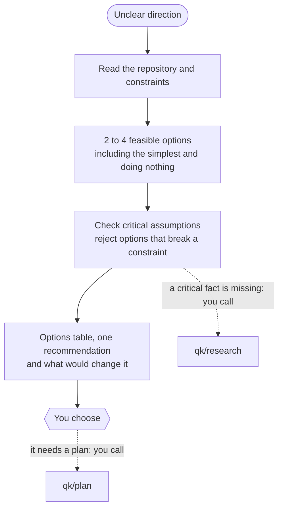

# qk/brainstorm

Two to four approaches, their trade-offs and a recommendation.

[Tiếng Việt](../../vi/skills/qk-brainstorm.md) · [Docs index](../README.md) · [Skill source](../../../skills/qk-brainstorm/SKILL.md)

## When to use it

Use this when the direction is unclear, not when implementation is already decided. It compares 2–4 feasible options against the actual repository and constraints, including the simplest option and doing nothing or working manually.



## Example input

```text
/qk-brainstorm We need repeatable local setup for two developers. Compare a shell script, containers and keeping the manual checklist. No new hosted services; maintenance cost matters most.
```

This is Claude Code syntax; see [Getting started](../getting-started.md) for Codex and omp syntax.

## What you get

A problem statement; an options table covering gains, costs and reversibility; checked versus unchecked critical assumptions; one recommendation and the condition that would change it. Options that violate constraints are rejected with a reason. The final choice stays with you.

## Authority and completion

Read-only by default. It writes only when you ask and supply a path; it never implements. Done means every option has meaningful trade-offs and available evidence has been checked, not that a favourite option sounds persuasive.

If a critical fact is missing, explicitly call `qk/research`. Once you choose a direction, explicitly call `qk/plan` if the work needs a plan.

All higher-priority, runtime and repository rules still apply. This skill does not change models, permissions, hooks or configuration, and never invokes another qk skill automatically.
