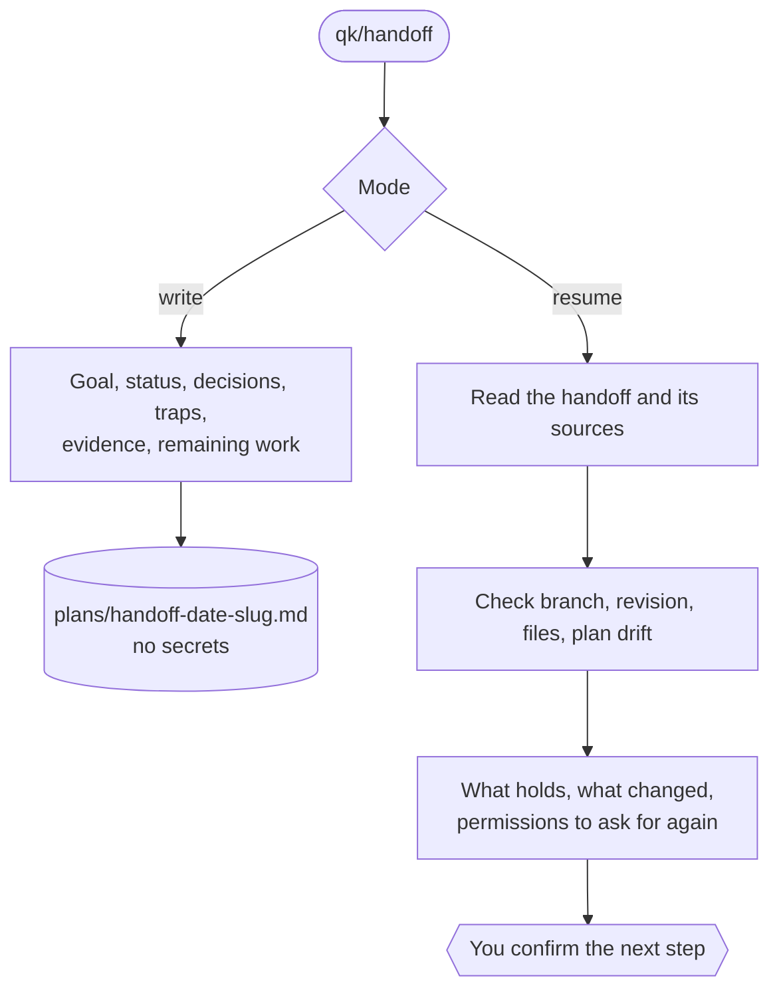

# qk/handoff

Session context saved, or resumed with drift checks.

[Tiếng Việt](../../vi/skills/qk-handoff.md) · [Docs index](../README.md) · [Skill source](../../../skills/qk-handoff/SKILL.md)

## When to use it

Use this before switching sessions or agents, and when resuming a saved handoff. It preserves decisions and evidence, not a transcript or authority to act.



## Examples

```text
/qk-handoff write Focus the next session on the remaining migration verification.
/qk-handoff resume plans/handoff-YYYYMMDD-migration.md
```

## Write mode

Default mode. Save according to repository convention, normally `plans/handoff-<YYYYMMDD>-<slug>.md`; if the repository offers no suitable location, ask for a path. Print the saved content unchanged in the reply, followed by the four closing report lines, which are not part of the file.

Include the goal, real status with revision, decisions/reasons, rejected approaches and traps, evidence pointers, remaining work/dependencies, authority granted in this session and a re-entry checklist. Link plans/issues/commits instead of duplicating them. Mark unrun verification as unverified. Remove secrets, tokens, customer data and private URLs.

## Resume mode

Read the handoff and cited sources; check branch, revision, working-tree state, file references and plan drift. Report what still holds, what changed, the sensible next step and permissions that must be obtained again. Wait for your confirmation before editing.

## Authority and completion

Write mode may write only the handoff file. Resume mode is read-only until you confirm the next step. Prior commit/push/merge/publish permissions do not transfer through a file.

Write is done when a new session need not rediscover settled decisions. Resume is done when drift has been exposed—not when the remaining implementation has silently started. You choose the next command.

If the [`qk` CLI](../ledger.md) is installed, a relevant ledger ID is known and writes are authorised, the skill saves one conclusion with `qk log claim`, recorded as a model claim; otherwise it skips this. It never invents an ID.

All higher-priority, runtime and repository rules still apply. This skill does not change models, permissions, hooks or configuration, and never invokes another qk skill automatically.
