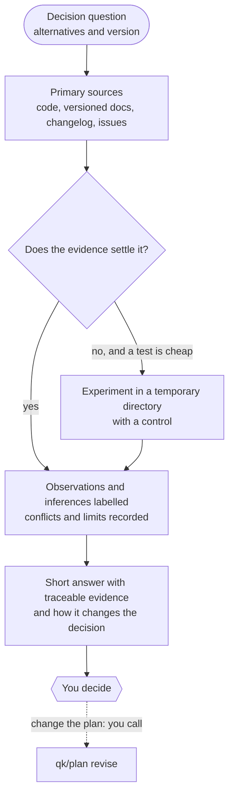

# qk/research

A decision question answered from primary sources and controlled experiments.

[Tiếng Việt](../../vi/skills/qk-research.md) · [Docs index](../README.md) · [Skill source](../../../skills/qk-research/SKILL.md)

## When to use it

Use this for a factual question that can change a decision. Give the question, the alternatives it separates and the relevant version. It is not an open-ended collection of links.



## Example input

```text
/qk-research Does the database version used by this repo support the migration we proposed in plans/search.md? Check official docs and a temporary experiment with a control. Report evidence only; do not modify the plan.
```

## What you get

A short answer with primary sources or reproducible commands for each conclusion. Observations and inferences are labelled separately. Contradictory sources, tool versions, experiment environment and untested limits are recorded, followed by how the answer changes the decision.

Source preference: project code, version-matched official docs, changelog and project issues. Blogs and forum answers are leads, not final authority. Experiments include a control where practical and their temporary directory is removed afterwards.

## Authority and completion

May read repository and external sources and experiment in temporary directories. No global package installation, runtime configuration changes or uploading sensitive code/data. A requested plan update changes only that plan's evidence section.

Done means conclusions are traceable, conflicts and limits are explicit. Then decide whether to keep the approach or explicitly call `qk/plan revise <path>`; research does not make that transition itself.

All higher-priority, runtime and repository rules still apply. This skill does not change models, permissions, hooks or configuration, and never invokes another qk skill automatically.
