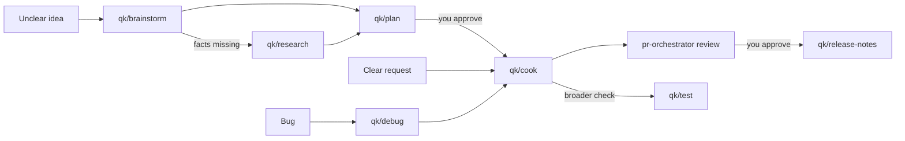

# Workflows

[Tiếng Việt](../vi/workflows.md) · [Docs index](README.md)

There is no fixed pipeline. Start from what is missing, run only the skills you need, and decide at each gate. Skills never call each other: each one ends by naming the next command, and you run it.

For prompts, authority gates and a concrete coordinator/worker-to-PR example, read the [CSV export case study](case-study-csv-export.md).

## Unclear idea → decision

1. `qk/brainstorm <problem>` — options, trade-offs, assumptions, a recommendation.
2. If an assumption decides the direction and is not checked yet: `qk/research <question>`.
3. You pick a direction. Deciding not to build is a valid outcome.
4. `qk/plan <chosen direction>` — writes `plans/<slug>.md`.
5. Optionally ask a second model to check it: `qk/agent-coord` with the review template, or `qk/plan audit plans/<slug>.md` in another runtime. Then `qk/plan revise` with the findings you accept.

Gate: you approve the plan. Approval of a plan is not approval to commit, merge or publish.

## Clear change → reviewed diff

1. `qk/cook plans/<slug>.md` (or `qk/cook <request with acceptance criteria>`).
2. cook reads the plan and repository rules, makes the smallest change, runs the checks that prove the acceptance criteria, reviews its own diff, and reports files, commands with real results, and anything unverified.
3. For an independent review: `pr-orchestrator review` on the pull request, or `qk/agent-coord` to a reviewer from a different model family.
4. For a broader or independent test run: `qk/test`.

Gate: you decide on commit, push and merge; cook does none of these unless you ask in the chat for that specific action.

## Bug → fix

1. `qk/debug <symptom>` — reproduction, root cause with `file:line`, rejected hypotheses, proposed minimal fix. No product code is changed.
2. `qk/cook` with the confirmed cause as input — fix, rerun the reproduction, run regression checks.

If you explicitly requested both diagnosis and immediate repair, debug follows the cook contract inline without loading another skill.

## Switching session, runtime or model

1. Before leaving: `qk/handoff write <focus of the next session>` — saves `plans/handoff-<date>-<slug>.md` and prints the same text.
2. In the new session: `qk/handoff resume plans/handoff-<…>.md` — compares the handoff with the repository (branch, revision, status, files, plan changes), reports drift and the authority to ask for again, then waits.

A handoff carries context, never authority. Permissions granted in one session must be granted again in the next.

## Second opinion or isolated worker

`qk/agent-coord` gives one bounded task to the agent and model you name — a read-only review, an implementation in its own worktree, a diagnosis — then checks the result before accepting it. See [qk/agent-coord](skills/qk-agent-coord.md).

## Release

1. `qk/release-notes v0.1.0..HEAD` (or a list of PRs) — a draft grouped by what users notice, traceable to commits or PRs.
2. You review the draft.
3. Tagging and publishing follow the repository's release process or pr-orchestrator's release mode, on a separate request.
