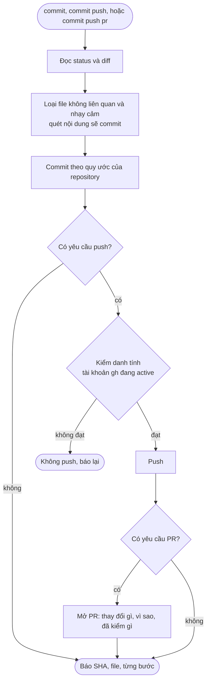

# qk/commit

Commit đúng phạm vi; chỉ push và mở PR khi được yêu cầu, sau bước kiểm account.

[English](../../en/skills/qk-commit.md) · [Mục lục](../README.md) · [Nguồn skill](../../../skills/qk-commit/SKILL.md)

## Khi nào dùng

Gọi `qk/commit` khi công việc đã xong cần được commit. Nêu rõ các bước được phép: `commit`, `commit push` hoặc `commit push pr`. Skill đọc status và diff, loại file không liên quan hoặc nhạy cảm, quét nội dung sắp commit và theo quy ước commit message của repo. Báo cáo có SHA, danh sách file và trạng thái thật của từng bước được yêu cầu.



## Ví dụ đầu vào

```text
/qk-commit commit push pr
```

Dùng `$qk-commit` trong Codex hoặc `/skill:qk-commit` trong omp (interactive/RPC).

## Quyền hạn và khi nào xong

Skill chỉ chạy các bước đã nêu. Trước khi push, nó chạy [kiểm tra danh tính](../../../skills/qk-commit/scripts/qk_preflight.py) với tài khoản `gh` đang hoạt động. Kiểm tra lỗi thì dừng push; nếu thiếu script, skill không push và báo rằng không thể kiểm tra tài khoản. Người dùng chọn tài khoản cần dùng. Mô tả PR ghi nội dung, lý do và các lệnh kiểm đã thực sự chạy trong phiên. Skill không amend, force-push, đổi tài khoản, merge hay tag.

Mẹo: Nếu kiểm tra danh tính không đạt vì repo thuộc một tài khoản khác đã đăng nhập, bạn có thể chạy một lệnh bằng tài khoản đó mà không đổi tài khoản đang hoạt động, ví dụ `GH_TOKEN=$(gh auth token --user <name>) git push -u origin <branch>`. Cách này chạy được khi git dùng `gh` làm credential helper (`gh auth setup-git`). Skill không đọc token hoặc đổi tài khoản; hãy tự chạy lệnh này hoặc yêu cầu rõ ràng.
