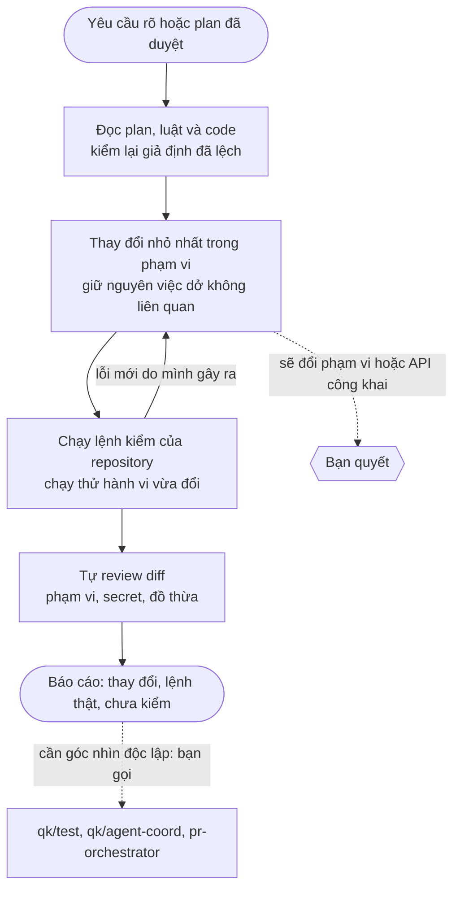

# qk/cook

Yêu cầu rõ hoặc plan đã duyệt được triển khai, kiểm chứng và tự review.

[English](../../en/skills/qk-cook.md) · [Mục lục](../README.md) · [Nguồn skill](../../../skills/qk-cook/SKILL.md)

## Khi nào dùng

Dùng để triển khai yêu cầu đã rõ tiêu chí xong hoặc plan đã duyệt. Đây là lệnh làm việc, không thêm một tầng lập kế hoạch.



## Ví dụ đầu vào

```text
/qk-cook plans/health-endpoint.md Triển khai plan đã duyệt. Kiểm endpoint trên app chạy thật. Không commit hoặc push.
```

Việc nhỏ có thể giao thẳng hành vi cần đạt, điều không được đổi và cách quan sát thành công; không cần tạo plan chỉ để đủ quy trình.

## Cách làm

1. Đọc yêu cầu/plan, luật repo và mã liên quan. Kiểm lại giả định nếu code đã đổi từ lúc viết plan.
2. Giữ nguyên thay đổi cục bộ không thuộc việc; không stash hoặc ghi đè.
3. Sửa nhỏ nhất trong phạm vi, theo quy ước hiện có.
4. Tìm lệnh kiểm từ repo, chạy kiểm tập trung và phần liên quan; hành vi chạy được thì chạy thật một lần.
5. Tự review diff về phạm vi, secret và chẩn đoán còn sót; cập nhật tiến độ trong plan nếu đang làm theo plan.

Plan lệch thực tế thì chọn điều chỉnh nhỏ nhất vẫn đúng mục tiêu, ghi lý do. Đổi hành vi người dùng thấy, API công khai hoặc vượt phạm vi phải dừng để bạn quyết.

## Kết quả, quyền và tiêu chí xong

Báo hành vi đã làm, file và lý do, lệnh/kết quả thật, phần chưa kiểm và điểm lệch plan. Lỗi có sẵn là baseline, không phải lý do nới test hoặc bỏ hook.

Được sửa file trong phạm vi và chạy kiểm của repo. Không commit, push, merge, tag, deploy hay đăng ra ngoài nếu chưa được cấp quyền rõ cho hành động đó. Worker được giao ghi phải ở worktree được chỉ định.

Xong khi mọi tiêu chí đã có bằng chứng quan sát và lỗi do thay đổi gây ra đã sửa. Muốn góc nhìn độc lập: tự gọi dự án riêng `pr-orchestrator` cho PR, hoặc `qk/agent-coord` với reviewer/model chỉ định. `qk/test` là kiểm độc lập hoặc rộng hơn nếu cần, không phải bước bắt buộc.

Nếu có [CLI `qk`](../ledger.md), biết ID liên quan trong sổ và được phép ghi, skill lưu một kết luận bằng `qk log claim`, ghi nhận là lời khẳng định của model; không thì bỏ qua. Không bao giờ bịa ID.

Chỉ dẫn cấp cao hơn, luật runtime và repo luôn thắng. Skill không đổi model, quyền, hook hay cấu hình và không tự gọi skill qk khác.
