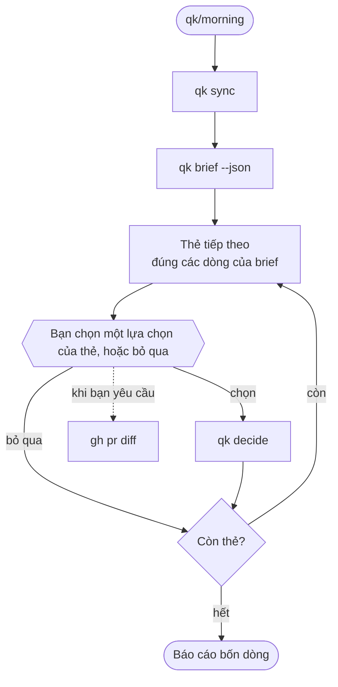

# qk/morning

Đọc brief buổi sáng ngay trong chat và ghi lại quyết định của bạn.

[English](../../en/skills/qk-morning.md) · [Mục lục](../README.md) · [Nguồn skill](../../../skills/qk-morning/SKILL.md)

## Khi nào dùng

Dùng sau một đêm chạy drain hoặc một job harness, khi `qk brief --pending` (hoặc lời nhắc lúc mở phiên từ [adapter runtime](../runtime-status.md)) báo có thẻ chờ quyết. Skill thay việc gõ phím trong brief trên terminal, không thay việc quyết.



## Ví dụ

```text
/qk-morning
```

## Skill làm gì

Skill chạy `qk sync`, rồi `qk brief --json`. Với mỗi thẻ, nó hiện đúng các dòng của brief và hỏi bạn chọn một trong các lựa chọn của thẻ, hoặc bỏ qua. Claude Code hỏi bằng hộp thoại; các runtime khác hỏi bằng chữ. Câu trả lời được ghi bằng `qk decide`; skill chỉ thêm cách merge khi bạn nói rõ. Bạn có thể yêu cầu xem diff của PR.

## Quyền hạn và khi nào xong

Skill được chạy `qk sync`, `qk brief --json`, `qk decide`, và `gh pr diff` khi bạn yêu cầu. Nó không bao giờ chọn thay bạn, không merge ngoài `qk decide`, không chạy `qk run resume` hay `qk run abort`; `abort-later` và `resume-later` chỉ ghi ý định. Skill xong khi mọi thẻ đã được quyết hoặc bỏ qua, kèm báo cáo bốn dòng.
