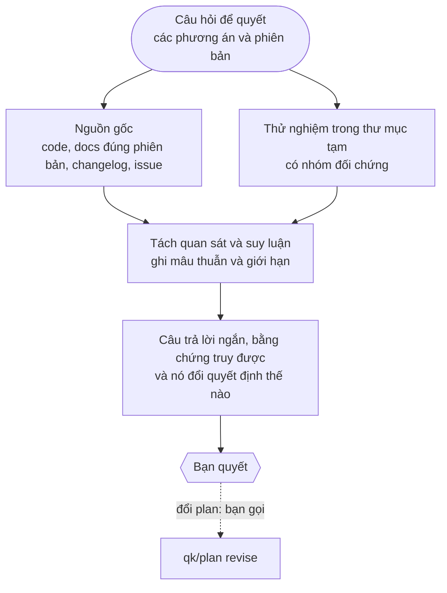

# qk/research

Câu hỏi quyết định được trả lời từ nguồn chính và thí nghiệm có đối chứng.

[English](../../en/skills/qk-research.md) · [Mục lục](../README.md) · [Nguồn skill](../../../skills/qk-research/SKILL.md)

## Khi nào dùng

Dùng cho câu hỏi thực tế có thể làm đổi quyết định. Nêu câu hỏi, các lựa chọn mà câu trả lời phân định và phiên bản liên quan. Không dùng để gom link không có mục tiêu.



## Ví dụ đầu vào

```text
/qk-research Phiên bản database repo đang dùng có hỗ trợ migration trong plans/search.md không? Đọc tài liệu chính thức và thử trong thư mục tạm, có đối chứng. Chỉ báo bằng chứng, chưa sửa plan.
```

## Nhận được gì

Câu trả lời ngắn; từng kết luận có nguồn chính hoặc lệnh tái hiện. Tách điều đã quan sát với suy luận; ghi nguồn mâu thuẫn, phiên bản công cụ, môi trường thử và phần chưa thử. Kết thúc bằng ảnh hưởng tới quyết định.

Ưu tiên mã nguồn, tài liệu chính thức đúng phiên bản, changelog và issue dự án. Blog/diễn đàn chỉ là manh mối. Khi hợp lý, phép thử có đối chứng để chứng minh nó phân biệt được kết quả; dọn thư mục tạm sau khi xong.

## Quyền và tiêu chí xong

Được đọc repo, nguồn ngoài và thử trong thư mục tạm. Không cài package toàn cục, đổi cấu hình runtime hay gửi mã/dữ liệu nhạy cảm ra ngoài. Nếu bạn yêu cầu ghi vào plan, chỉ sửa mục bằng chứng của plan đó.

Xong khi kết luận truy được nguồn, mâu thuẫn và giới hạn được nêu rõ. Bạn quyết giữ hay đổi hướng rồi tự gọi `qk/plan revise <path>`; nghiên cứu không tự chuyển sang sửa kế hoạch.

Chỉ dẫn cấp cao hơn, luật runtime và repo luôn thắng. Skill không đổi model, quyền, hook hay cấu hình và không tự gọi skill qk khác.
