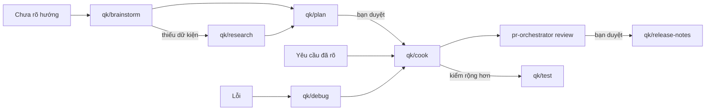

# Quy trình

[English](../en/workflows.md) · [Mục lục](README.md)

Không có pipeline cố định. Bắt đầu từ điều còn thiếu, chỉ dùng skill cần thiết, bạn quyết tại từng cổng. Skill không tự gọi nhau: nó nêu lệnh tiếp theo để bạn gọi. Muốn giao trọn một việc đã rõ cho agent, chỉ một cổng duyệt plan và kết thúc bằng PR, hãy khởi động [runner qk-run](runner.md) (chỉ chạy khi bạn gọi).

Xem [case study xuất CSV](case-study-csv-export.md) để có prompt cụ thể, cổng quyền và ví dụ coordinator/worker đến PR.

## Ý tưởng mơ hồ → quyết định

1. `qk/brainstorm <vấn đề>`: hướng đi, đánh đổi, giả định, khuyến nghị.
2. Giả định quyết định hướng mà chưa kiểm: `qk/research <câu hỏi>`.
3. Bạn chọn hướng. Không xây cũng là kết quả hợp lệ.
4. `qk/plan <hướng đã chọn>` ghi `plans/<slug>.md`.
5. Nếu cần ý kiến khác: `qk/agent-coord` với mẫu review hoặc `qk/plan audit plans/<slug>.md` ở runtime khác. Sau đó `qk/plan revise` với finding bạn chấp nhận.

Cổng: bạn duyệt plan. Duyệt plan không duyệt commit, merge hoặc đăng.

## Thay đổi rõ → diff đã review

1. `qk/cook plans/<slug>.md` hoặc `qk/cook <yêu cầu có tiêu chí xong>`.
2. Cook đọc luật repo, sửa nhỏ nhất, kiểm tiêu chí, tự review diff và báo file/lệnh/kết quả thật/phần chưa kiểm.
3. Muốn review độc lập: `pr-orchestrator review` trên PR hoặc `qk/agent-coord` giao reviewer khác họ model.
4. Muốn kiểm rộng hơn hoặc độc lập: `qk/test`.

Cổng: bạn quyết commit/push/merge. Cook không làm các việc đó nếu chat chưa yêu cầu rõ hành động cụ thể.

Khi sẵn sàng commit hoặc mở PR, gọi [qk/commit](skills/qk-commit.md) và nêu các bước được phép.

## Lỗi → bản sửa

1. `qk/debug <triệu chứng>`: tái hiện, nguyên nhân có `file:line`, giả thuyết đã loại, bản sửa tối thiểu đề xuất. Mặc định chưa sửa sản phẩm.
2. `qk/cook` với nguyên nhân đã kiểm: sửa, chạy lại tái hiện và kiểm hồi quy.

Nếu chat đã yêu cầu debug và sửa ngay, debug áp hợp đồng cook tại chỗ, không nạp skill khác.

## Chuyển phiên, runtime hoặc model

1. Trước khi rời: `qk/handoff write <trọng tâm phiên sau>` lưu `plans/handoff-<date>-<slug>.md`, in cùng nội dung.
2. Phiên mới: `qk/handoff resume <path>` đối chiếu repo (branch/revision/status/file/plan), báo độ lệch và quyền cần xin lại, rồi chờ.

Bàn giao truyền ngữ cảnh, không truyền quyền. Quyền phiên cũ cần cấp lại ở phiên mới.

## Ý kiến thứ hai hoặc worker cô lập

`qk/agent-coord` giao một việc có giới hạn cho agent/model bạn nêu, rồi kiểm kết quả trước khi chấp nhận. Xem [hướng dẫn](skills/qk-agent-coord.md).

## Phát hành

1. `qk/release-notes v0.1.0..HEAD` hoặc danh sách PR: nháp theo hành vi người dùng, truy được commit/PR.
2. Bạn duyệt nháp.
3. Tag/đăng theo quy trình repo hoặc release mode của pr-orchestrator, bằng yêu cầu riêng.
