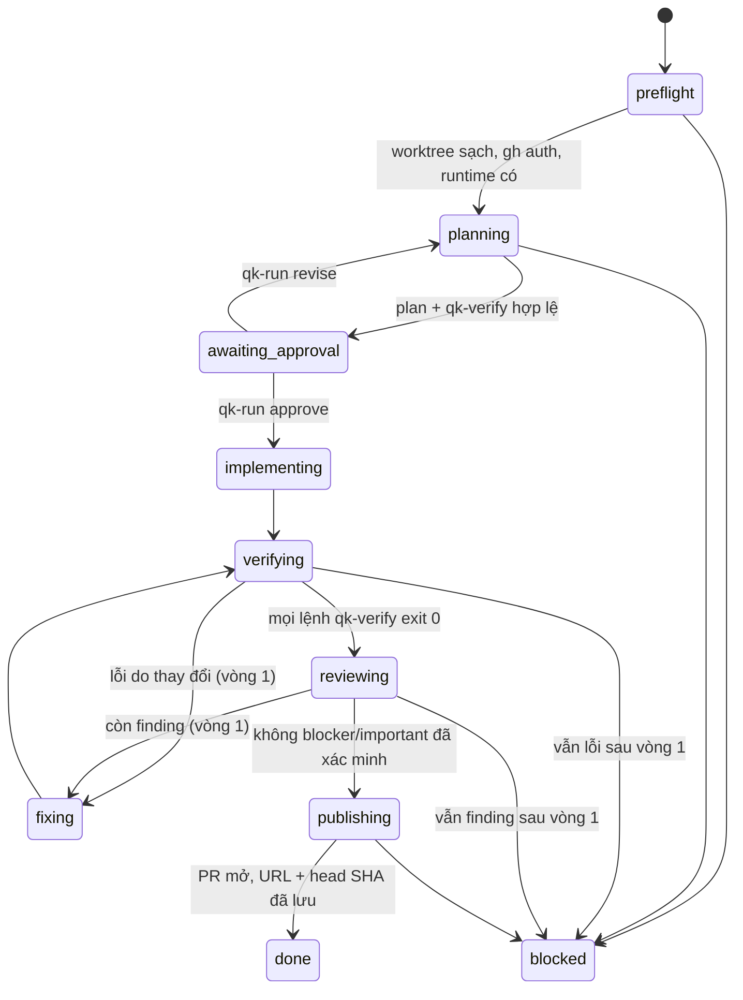

# qk-run: runner tự động từ yêu cầu đến PR

Trạng thái: đã triển khai — 2026-11-08. Lệch so với plan: bước planning chạy chỉ đọc và trả plan cho runner lưu (agent đã để lại `__pycache__` khi được ghi); runner xoá file do lệnh kiểm tạo ra (smoke đầu tiên đã commit `.pyc`); omp ghi dùng `--approval-mode yolo` vì `write` vẫn hỏi trước bash; Claude chỉ đọc dùng `--tools Read,Grep,Glob` vì `plan` mode vẫn chạy được lệnh. Commit message là tiêu đề plan, chưa tự dò convention của repo; finding chỉ được đối chiếu theo file, chưa theo dòng trong diff. Sau review PR #1: plan được đóng băng khi `approve`, trạng thái worktree kỳ vọng được lưu để `resume` không hợp thức hoá vi phạm. Smoke 2–5 được phủ bằng unit test với repo Git thật, không chạy riêng trên GitHub.

## Mục tiêu và ngoài phạm vi

**Mục tiêu:** một lệnh nhận yêu cầu, tự điều phối các bước qk trên Claude Code, Codex hoặc omp, dừng **một lần** để người dùng duyệt plan, rồi tự chạy đến khi mở được PR đã kiểm chứng — hoặc dừng ở trạng thái `blocked` có lý do.

**Quyết định của người dùng (2026-11-08):**

| Câu hỏi | Chọn |
|---|---|
| Quyền tối đa | Commit + push nhánh riêng + mở PR. **Không merge** |
| Cổng người | Dừng một lần ở plan |
| Runtime | Đa runtime qua script runner |

**Ngoài phạm vi:** merge, release, tag, deploy, đóng PR, force-push, xoá nhánh; tự đổi model/provider khi hết quota; daemon/queue/chạy song song nhiều task; giao diện web; sửa 10 skill hiện có ngoài phần docs nguyên tắc.

## Hiện trạng và bằng chứng

- [Đã kiểm] qk có 10 skill explicit-only; nguyên tắc hiện tại: "không pipeline bắt buộc, skill không tự gọi nhau" (`README.md:26`, `docs/en/workflows.md:5`). Runner phải là lớp **opt-in riêng**; các skill vẫn không tự gọi nhau.
- [Đã kiểm] Gọi headless bằng cách yêu cầu agent đọc trực tiếp `skills/<name>/SKILL.md` đã chạy được trên Codex (`codex exec`) và omp (`omp -p --mode json`) trong các smoke trước. Cách này không phụ thuộc cú pháp gọi skill native của từng runtime, và tránh lỗi `omp -p` không mở rộng `/skill:` (`docs/en/runtimes.md`).
- [Đã kiểm] omp có goal mode tự chạy đến khi xong, nhưng chỉ trong omp; không dùng làm vòng lặp chung vì đã chọn đa runtime.
- [Đã kiểm] Repo chưa có test suite; CI chỉ chạy `scripts/validate.py` và gitleaks. Validator viết bằng Python stdlib.
- [Suy đoán] Cờ CLI (`claude -p --output-format json --permission-mode`, `codex exec --json -s workspace-write`, `omp -p --mode json --tools`) phải kiểm lại bằng `--help` của bản đang cài trước khi khóa adapter.

## Quyết định

| Quyết định | Chọn | Lý do / hướng bị bác |
|---|---|---|
| Ngôn ngữ runner | Python 3.9+ stdlib, một file `scripts/qk_run.py` | Đồng bộ validator, không dependency. Bác: Node/Bun (thêm runtime), framework agent (vượt nhu cầu) |
| Cách gọi bước | Prompt qua stdin: "đọc `<skill path>` rồi làm theo, trả về khối `qk-result`" | Đồng nhất mọi runtime. Bác: cú pháp native từng runtime |
| Ai được ghi git | **Chỉ runner** commit/push/mở PR. Agent chỉ sửa file | Quyền ra ngoài nằm ở một chỗ kiểm được. Agent tự commit → vi phạm, dừng |
| Cô lập | Một `git worktree` + nhánh `qk/<slug>` riêng ngoài checkout của người dùng | Không đụng thay đổi dở của người dùng; một writer mỗi checkout |
| Trạng thái | File JSON ngoài repo: `$XDG_STATE_HOME/qk-run/<id>/` (mặc định `~/.local/state/qk-run/<id>/`) | Resume được, không làm bẩn repo |
| Điều kiện "xong" | Runner tự chạy lệnh kiểm chứng trong khối `qk-verify` của plan và đọc kết quả review có cấu trúc | Không tin câu "done" của agent |
| Review | Một model khác họ với model triển khai, read-only, findings JSON có `file:line` | Giữ nguyên tinh thần audit chéo; pr-orchestrator vẫn dùng được sau khi có PR |
| Vòng sửa | Tối đa **một** vòng fix → test → review lại | Khớp cổng pr-orchestrator; tránh lặp vô hạn |
| Lỗi runtime | Hết quota/auth/model không có → `blocked`, không fallback | Theo hợp đồng `qk/agent-coord` |

## Luồng trạng thái



Mọi trạng thái `blocked` lưu lý do, bước, log và lệnh để người dùng tiếp tục (`qk-run resume <id>`).

## Thay đổi dự kiến

| File | Nội dung |
|---|---|
| `scripts/qk_run.py` | CLI: `start`, `status`, `approve`, `revise`, `resume`, `abort`. State machine, adapter 3 runtime, chạy lệnh verify, commit/push/PR qua `git`/`gh` |
| `tests/test_qk_run.py` | `unittest` với adapter giả: chuyển trạng thái, điều kiện dừng, resume, chống agent tự commit, giới hạn một vòng fix, không fallback model |
| `.github/workflows/validate.yml` | Thêm `python3 -m unittest discover tests` |
| `docs/en/runner.md`, `docs/vi/runner.md` | Cách dùng, quyền, trạng thái, giới hạn |
| `README.md`, `README.vi.md`, `docs/*/README.md`, `docs/*/workflows.md` | Sửa câu "không pipeline / không tự gọi" thành: skill không tự gọi nhau; runner là lớp điều phối opt-in |
| `CHANGELOG.md` | Mục Added |

Giao diện dự kiến:

```bash
python3 scripts/qk_run.py start "<yêu cầu có tiêu chí xong>" \
  --repo <path> --impl codex:gpt-6.1-sol --review omp:anthropic/claude-opus-5-5
python3 scripts/qk_run.py approve <id>
python3 scripts/qk_run.py status <id>
```

Hợp đồng khối kết quả cho mọi bước (agent in ở cuối output):

````text
```qk-result
{"status": "done|blocked|needs_input", "summary": "...", "files": [...], "evidence": [...], "reason": "..."}
```
````

Plan phải có khối `qk-verify` (danh sách lệnh lấy từ repo); thiếu → runner không cho approve.

## Các bước

| # | Việc | Xong khi |
|---|---|---|
| 1 | Kiểm `--help` của `claude`, `codex`, `omp` đang cài; khóa cờ headless, model, quyền, output JSON cho từng adapter | Bảng cờ đã kiểm ghi vào docs; mỗi adapter chạy được một prompt "echo qk-result" thật |
| 2 | State machine + lưu/đọc state + CLI `start/status/approve/revise/resume/abort` | Test với adapter giả phủ mọi cạnh trong sơ đồ |
| 3 | Preflight: repo sạch, `gh auth status`, base từ remote mặc định, tạo worktree + nhánh không trùng | Từ chối khi worktree người dùng bẩn hoặc nhánh đã tồn tại; test |
| 4 | Bước planning/implementing/fixing: dựng prompt từ SKILL.md tương ứng (`qk-plan`, `qk-cook`), parse `qk-result`, kiểm HEAD không đổi sau agent | Agent tự commit → `blocked`; output thiếu khối kết quả → `blocked` |
| 5 | Verifying: runner tự chạy `qk-verify` trong worktree, lưu exit code và log | Không có lệnh nào được coi pass nếu chưa chạy |
| 6 | Reviewing: model khác họ, read-only, findings JSON; runner chỉ chuyển `fixing` cho finding có `file:line` tồn tại trong diff | Cùng họ model với impl → từ chối khi start |
| 7 | Publishing: commit theo convention repo (không dòng tác giả AI), push nhánh, `gh pr create` với body gồm plan, lệnh verify + exit code, findings đã xử lý/còn lại | PR URL + head SHA lưu trong state; chạy lại `resume` không tạo PR trùng |
| 8 | Docs EN/VI, sửa câu nguyên tắc, CHANGELOG, CI chạy unittest | `validate.py` và unittest xanh |
| 9 | Smoke thật trên repo tạm có remote GitHub riêng | Xem Kiểm chứng |

## Kiểm chứng

- `python3 -m unittest discover tests` và `python3 scripts/validate.py` exit 0, local và CI.
- Smoke thật (repo GitHub tạm do người dùng chỉ định, không dùng repo thật):
  1. Task nhỏ có test sẵn: chạy `start` → dừng ở `awaiting_approval` → `approve` → kết thúc `done` với PR mở, CI của PR chạy, body PR có lệnh verify + exit code thật.
  2. Đối chứng thất bại: task cố ý không thể pass test → dừng `blocked` sau đúng một vòng fix, không commit/push.
  3. Agent cố commit (prompt fixture) → `blocked`, nhánh remote không đổi.
  4. Model review cùng họ với impl → bị từ chối ở `start`.
  5. Ngắt giữa chừng rồi `resume` → không tạo commit/PR trùng.
- Mỗi runtime (Claude, Codex, omp) ít nhất chạy được bước planning thật; chỉ tuyên bố hỗ trợ runtime đã chạy smoke 1.

## Rủi ro

| Rủi ro | Tín hiệu | Phản ứng |
|---|---|---|
| Cờ CLI đổi giữa phiên bản | Adapter lỗi parse/exit | Bước 1 kiểm `--help`; adapter báo `blocked` kèm phiên bản, không đoán |
| Agent sửa ngoài worktree | Checkout của người dùng hoặc file ngoài repo đổi | Chạy agent với `cwd` = worktree và cờ giới hạn quyền của runtime; worktree không phải sandbox — ghi rõ trong docs |
| Tốn token/thời gian | Bước chạy quá lâu | Timeout mỗi bước, tổng thời gian tối đa, một vòng fix |
| Plan duyệt rồi nhưng code lệch | Review phát hiện ngoài scope | Finding loại scope → fixing; vẫn lệch → `blocked` |
| Mâu thuẫn nguyên tắc "không pipeline" | Người đọc hiểu nhầm skill tự nối nhau | Sửa câu trong README/docs ở bước 8 |

## Quyết định bổ sung (2026-11-08)

| Câu hỏi | Chọn |
|---|---|
| Model | Có mặc định: impl `omp:anthropic/claude-opus-5-5`, review `codex` với model mặc định của Codex (khác họ). Ghi đè bằng `--impl` / `--review` |
| Repo smoke | Tự tạo repo private tạm bằng `gh repo create` khi kiểm chứng; chỉ xoá khi người dùng cho phép riêng, nếu không thì báo tên repo |
| Dạng PR | Ready for review, không draft |

Không còn câu hỏi mở.
